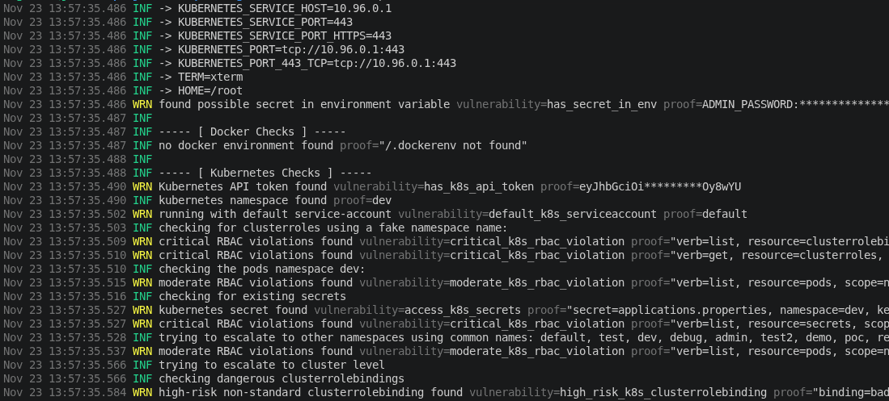

# CONQUEROR

**Container Query, Oberservation and Recon**

A lightweight vulnerability and security-posture scanner built to run inside containers, specifically targeting Docker and Kubernetes environments.

Checks include:
- **OS level:** user/groups, privileged container status, read-only root filesystem, Linux capabilities, environment variables
- **Docker level:** exposed Docker daemon or mounted Docker socket inside the container
- **Kubernetes level:** ServiceAccount RBAC permissions in the pod's namespace, across other namespaces, and ClusterRoles/ClusterRoleBindings
- **cloud environment detection:** Detect a provider and check for sensitive endpoints being exposed.

Output includes:
- Standard logging with terminal colors
- Machine-readable JSON via `--json`

## Build

Requires Go 1.26.11+. Compile a static, dependency-free binary ready to copy into minimal containers:

```bash
go mod download

# Linux x86_64
CGO_ENABLED=0 GOOS=linux GOARCH=amd64 go build -trimpath -ldflags="-s -w" -o conqueror ./cmd/user-tool

# Linux ARM64
CGO_ENABLED=0 GOOS=linux GOARCH=arm64 go build -trimpath -ldflags="-s -w" -o conqueror ./cmd/user-tool
```

## Deploy & Run

### Docker

```bash
# Deploy
container="name-of-your-container"
docker cp ./conqueror $container:/tmp/conqueror

# Run with standard logging to terminal:
docker exec -it $container /tmp/conqueror

# Run with JSON output to terminal:
docker exec -i $container /tmp/conqueror --json
```

### Kubernetes

```bash
# Deploy
namespace="your-namespace"
deployment="your-deployment"
pod=$(kubectl get pods -n $namespace -l app=$deployment -o jsonpath='{.items[0].metadata.name}')
kubectl cp ./conqueror $namespace/$pod:/tmp/conqueror
kubectl exec -n $namespace $pod -- chmod +x /tmp/conqueror

# Run with standard logging to terminal:
kubectl exec -it -n $namespace $pod -- /tmp/conqueror

# Run with JSON output to terminal:
kubectl exec -i -n $namespace $pod -- /tmp/conqueror --json
```

### Example output



## What to do with the findings?

If you need help in professionally rating and resolving those findings for your environment,
feel free to connect with me on linkedin or upwork:
- https://linkedin.com/in/florian-krutzler-b546253b9
- https://www.upwork.com/freelancers/~014e7753a9142b48d6

## Security, Compliance & Transparency

Because `CONQUEROR` is designed to run directly inside sensitive container environments, it follows strict transparency and least-privilege principles:

- **Non-Destructive & Read-Only by Design:** All checks are passive or read-only. `CONQUEROR` never modifies files, processes, container configurations, or Kubernetes resources.
- **Sensitive Data Redaction:** Designed to prevent accidental credential exposure. Typical credential sources (Kubernetes tokens & secrets, OS-level files, environment variables) are inspected, with values matching sensitive patterns automatically masked prior to output.
- **No External Telemetry:** No scan results or telemetry are transmitted to external servers. All findings are written exclusively to `stdout` (terminal logs or JSON).
- **Auditable System & Network Access:**
  - **Filesystem & OS (`os`, `os/user`):** Reads `/proc`, `/etc`, environment variables (`os.Environ`), hostname, user/group IDs, mount information, and typical container-related files such as `/.dockerenv` or `docker.sock`.
  - **Subprocess (`os/exec`):** Executes a single read-only command (`uname -a`) to determine kernel details.
  - **Local Network & Sockets (`net`):** Inspects local network interfaces (`net.InterfaceAddrs`) and probes local Unix/TCP sockets (`net.DialTimeout`) for exposed Docker daemons.
  - **Cloud Metadata (`net/http`):** Performs read-only `GET` requests to the link-local address `http://169.254.169.254` to detect cloud provider metadata endpoints (AWS, GCP, Azure, etc.).
  - **Kubernetes API (`k8s.io/client-go`):** Uses the pod's mounted ServiceAccount token (in-cluster config) to perform read-only RBAC self-subject access reviews and permission checks.

## License

Licensed under the [Apache License, Version 2.0](LICENSE).

## Disclaimer

`CONQUEROR` is provided "as is", without warranty of any kind. Security checks and data redaction rely on best-effort heuristics and do not guarantee complete secret masking or the absence of vulnerabilities and misconfigurations. Always combine automated scans with manual reviews and defense-in-depth practices. Only run this tool on environments that you own or have explicit permission to test.
